# Puls — Arquitectura

Puls es un secuenciador de batería por pasos, **polirrítmico**, en formato **CLAP** (note effect). Emite notas MIDI al instrumento que le sigue (p. ej. Drum Machine de Bitwig); no es un sintetizador ni un sampler. Está construido sobre [DPF](https://github.com/DISTRHO/DPF) y su editor es nativo (DGL/NanoVG sobre OpenGL).

Este documento describe la estructura real del código. Las decisiones puntuales y su historia están en [`DECISIONS.md`](../DECISIONS.md) (ADR-0xx se cita donde corresponde); el uso, en [`README.md`](../README.md).

## Índice

1. [Principios](#1-principios)
2. [Vista general: capas y módulos](#2-vista-general-capas-y-módulos)
3. [Modelo de hilos](#3-modelo-de-hilos)
4. [Modelo de datos](#4-modelo-de-datos)
5. [Motor (`engine/`)](#5-motor-engine)
6. [Handoff main → audio](#6-handoff-main--audio)
7. [Bridge: comandos y eventos](#7-bridge-comandos-y-eventos)
8. [Editor nativo (`gui/` + `plugin/PulsUI.cpp`)](#8-editor-nativo)
9. [Persistencia y templates](#9-persistencia-y-templates)
10. [Undo/redo](#10-undoredo)
11. [Glue con DPF/CLAP (`plugin/`)](#11-glue-con-dpfclap-plugin)
12. [Build, dependencias y tests](#12-build-dependencias-y-tests)
13. [Diagnóstico](#13-diagnóstico)
14. [Plataformas y limitaciones](#14-plataformas-y-limitaciones)

---

## 1. Principios

Son reglas del proyecto (ver `CLAUDE.md`) y todo el diseño se deriva de ellas:

| # | Principio | Consecuencia arquitectónica |
|---|---|---|
| 1 | `engine/` no incluye DPF ni UI | Se compila y prueba sin host (`engine_tests`) |
| 2 | El hilo de audio (`run()`) no asigna memoria, no toma locks, no hace I/O, JSON ni logging | Handoff por buffers wait-free de tamaño fijo; el JSON vive solo en el hilo principal |
| 3 | La UI nunca agenda eventos musicales | Hasta las notas de preview del editor viajan por una cola al motor |
| 4 | Cerrar la UI no interrumpe la reproducción | Telemetría por atomics; el motor no conoce la UI |
| 5 | UI nativa DGL/NanoVG, mínimas dependencias, versiones fijadas | La geometría y la construcción de comandos (`gui/`) no dependen de DGL y se prueban headless |
| 6 | Tiempo musical entero | PPQ = 3840 y unidades enteras: ninguna acumulación en coma flotante (ADR-002) |

---

## 2. Vista general: capas y módulos

Las dependencias apuntan hacia abajo: una capa solo conoce a las que tiene debajo.

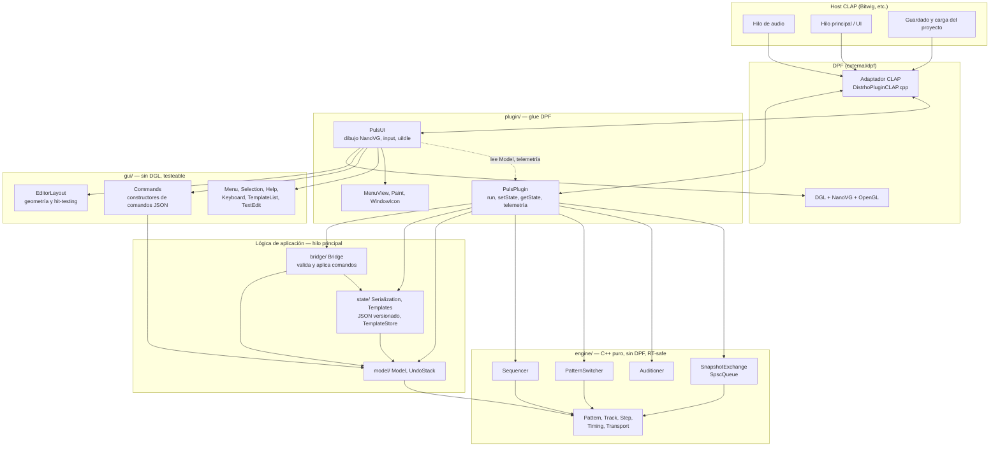

### Mapa de directorios

| Directorio | Rol | Depende de DPF | Hilo |
|---|---|---|---|
| `engine/` | Secuenciador, scheduling, switcher, auditioner, buffers lock-free, tipos de datos del patrón | No | Audio (y tipos compartidos) |
| `model/` | `Model` (estado editable, banco de 16 patrones), `UndoStack` | No | Principal |
| `state/` | Serialización JSON v2 (con migración v1), `Templates`, `TemplateStore` | No | Principal |
| `bridge/` | `Bridge`: comandos JSON → mutaciones validadas del `Model`, eventos de vuelta | No | Principal |
| `gui/` | Geometría, hit-testing, builders de comandos, menús como datos, selección, teclado, ayuda | No | Principal |
| `plugin/` | `PulsPlugin` (DSP), `PulsUI` (NanoVG), `MenuView`, `Paint`, `WindowIcon` | **Sí** | Todos |
| `templates/` | Kits built-in (`*.json`) embebidos al compilar | No | — |
| `third_party/` | `json.hpp` (nlohmann 3.11.3, fijado con sha256) | No | Solo no-RT |
| `tests/` | Tests headless + host CLAP headless | — | — |

---

## 3. Modelo de hilos

Hay exactamente **dos mundos** que casi nunca se tocan: el hilo de audio (`run()`) y el hilo principal (UI + comandos + estado del host). Todo el cruce es por estructuras *wait-free* o atómicos.

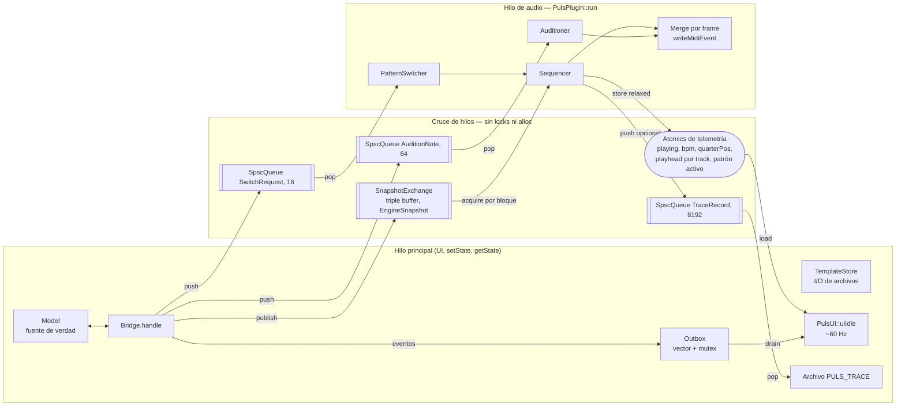

Reglas de propiedad:

| Dato | Escribe | Lee | Mecanismo |
|---|---|---|---|
| `Model` | Principal | Principal (incluida la UI, directamente) | Ninguno: un solo hilo |
| `EngineSnapshot` | Principal | Audio | `SnapshotExchange` (triple buffer) |
| Peticiones de cambio de patrón | Principal | Audio | `SpscQueue<SwitchRequest,16>` |
| Notas de preview | Principal | Audio | `SpscQueue<AuditionNote,64>` |
| Playheads, transporte, patrón sonando | Audio | UI | `std::atomic` relaxed |
| Outbox de eventos | Principal (Bridge) | Principal (UI idle) | `std::mutex` — **nunca** tomado en `run()` |
| Estado de `Sequencer`/`Switcher`/`Auditioner` | Audio | Audio | Privado al hilo de audio |

> En CLAP, `UI::setState("cmd", ...)` llega **síncronamente** a `Plugin::setState` en el hilo de la UI (`DistrhoPluginCLAP.cpp`, `setStateFromUI`), que es el hilo principal. Por eso la UI puede leer el `Model` sin copias (ADR-014).

---

## 4. Modelo de datos

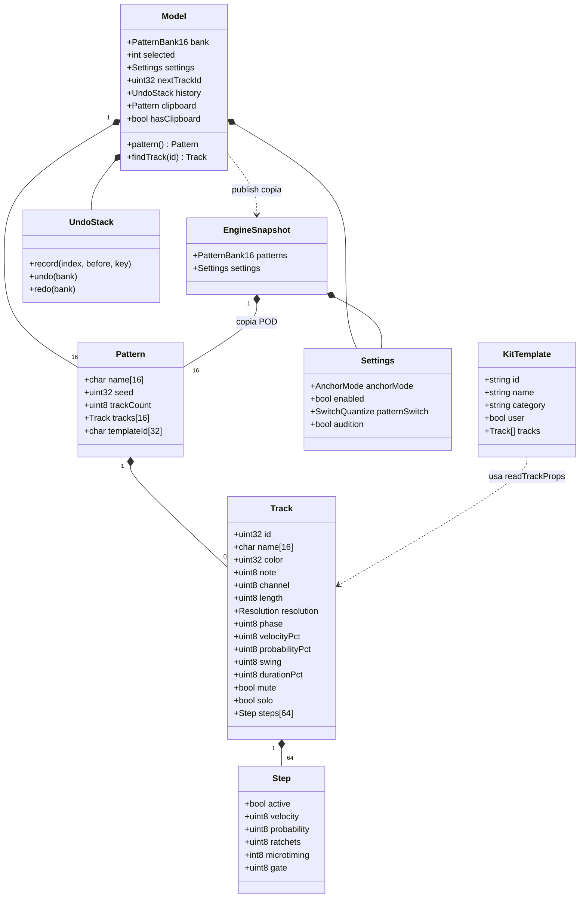

Puntos clave:

- **Todo es POD de tamaño fijo.** Un `Pattern` pesa ~7,5 KB; el banco completo ~120 KB. Eso permite copiarlo por `memcpy` al snapshot sin tocar el heap del audio.
- **Los tracks pertenecen al patrón**, no al proyecto. Cada patrón tiene su layout de hasta 16 tracks × 64 pasos.
- **IDs de track estables:** únicos por patrón, nunca reutilizados en la sesión (`nextTrackId` global). Los comandos direccionan tracks por id, no por índice, de modo que *undo* de un borrado devuelve el mismo id.
- **Una nota por canal y patrón** (ADR-021): `noteOwner`/`freeNote` en `model/Model.hpp`; lo hace cumplir el Bridge.
- `Pattern::templateId` lo ignora el motor; solo recuerda de qué kit vino el layout.

### Tiempo musical

`engine/Timing.hpp`: 1 negra = 3840 ticks (PPQ); 1 tick = 268 800 *unidades*. `268800 = 2⁹·3·5²·7`, de modo que todas las resoluciones (1/4 … 1/64 y tresillos 1/8T, 1/16T, 1/32T), ratchets 1–8 y porcentajes son enteros exactos. El punto flotante solo aparece al convertir a frames de muestra.

---

## 5. Motor (`engine/`)

### 5.1 Un bloque de audio, de punta a punta

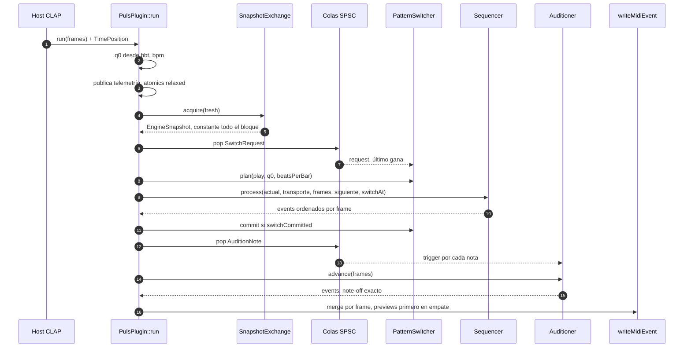

`play = settings.enabled && pos.playing && pos.bbt.valid`. Un secuenciador deshabilitado equivale a uno parado: libera las notas sonando y no emite nada.

### 5.2 Cómo el `Sequencer` decide qué suena

No guarda estado de reproducción por track. Cada paso de cada track tiene un inicio nominal en **su propia grilla**: `anchor + s · unitsPerStep`. Un bloque cubre una ventana semiabierta `[t0, t1)` de unidades musicales y emite los eventos (ratchets, swing y micro-timing ya aplicados) cuyo tiempo cae en ella. El número de paso se deriva de la posición absoluta, así que los cambios de tempo, el tamaño de bloque y los saltos no requieren estado por track.

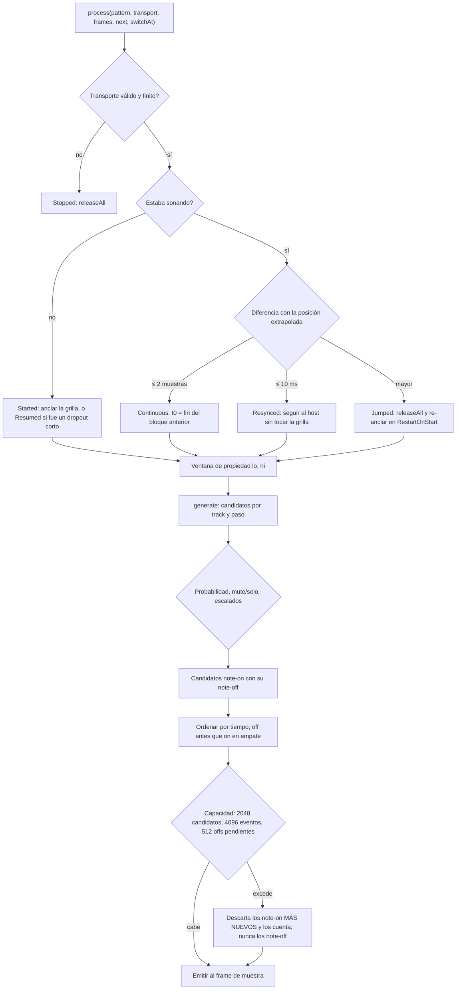

Propiedades garantizadas (y probadas en `EngineTests`):

- **Salida idéntica para cualquier tamaño de bloque** (probado de 1 a 4096): las ventanas de propiedad se acoplan exactamente y cada evento cae en el primer frame ≥ su tiempo.
- **Probabilidad determinista:** `splitmix64(seed, track, paso absoluto)` → mismo resultado siempre, sin RNG con estado.
- **Sin notas colgadas:** el `Sequencer` lleva la cuenta de las notas sonando (`active_`, `pending_`); reemplazar el patrón a mitad de nota (snapshot nuevo) o parar el transporte emite los note-off.

### 5.3 Estados de continuidad (`Sequencer::BlockKind`)

Introducidos por ADR-018 tras un caso real en Bitwig (rampa de tempo automatizada): un error pequeño de posición del host ya no reinicia el patrón.

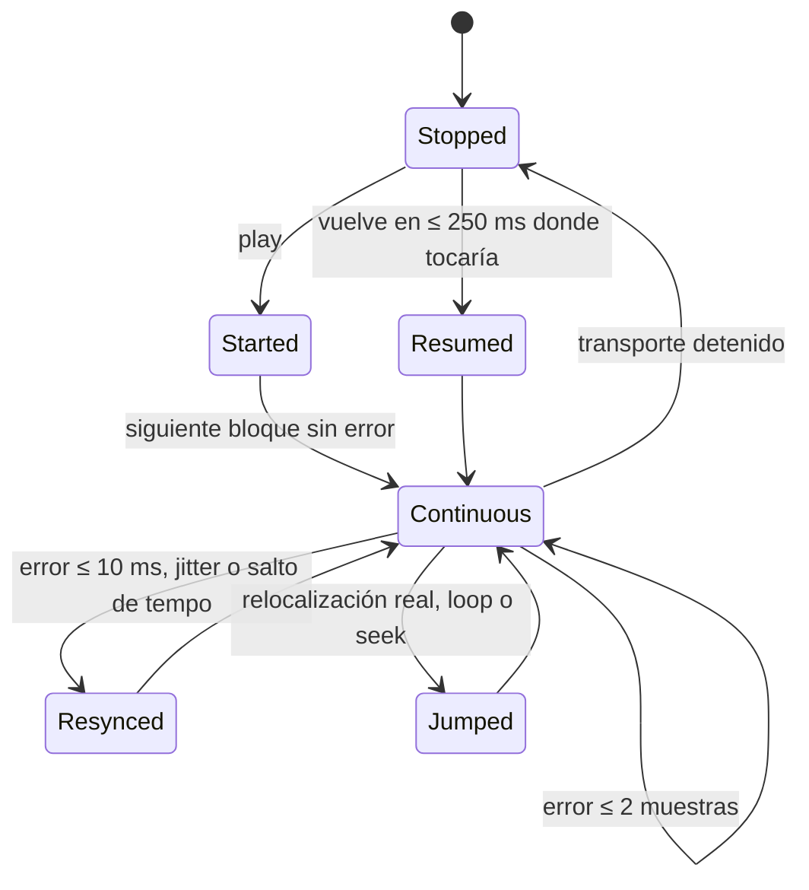

| Constante | Valor | Significado |
|---|---|---|
| `kResyncSeconds` | 10 ms | Error de posición tratado como jitter |
| `kMaxDropoutSeconds` | 250 ms | Dropout más largo = stop real |
| `kMaxCandidates` / `kMaxEvents` / `kMaxPendingOffs` | 2048 / 4096 / 512 | Capacidades fijas del bloque |

### 5.4 Modos de anclaje (`AnchorMode`)

| Modo | Comportamiento |
|---|---|
| `RestartOnStart` (por defecto) | La grilla se ancla donde empieza la reproducción y se re-ancla tras un salto; todos los tracks arrancan juntos desde su fase |
| `HostAbsolute` | La grilla se ancla en la posición 0 del host; los tracks mantienen su relación de fase con la canción |

Tracks con longitudes o resoluciones distintas derivan entre sí: eso es la polirritmia.

### 5.5 Cambio de patrón cuantizado

`PatternSwitcher` resuelve una petición a un **objetivo absoluto en unidades musicales**, así que el momento del cambio no depende del tamaño del bloque; el `Sequencer` lo aplica *por evento* (los eventos con tiempo ≥ objetivo salen del patrón nuevo). La grilla **no se re-ancla**.

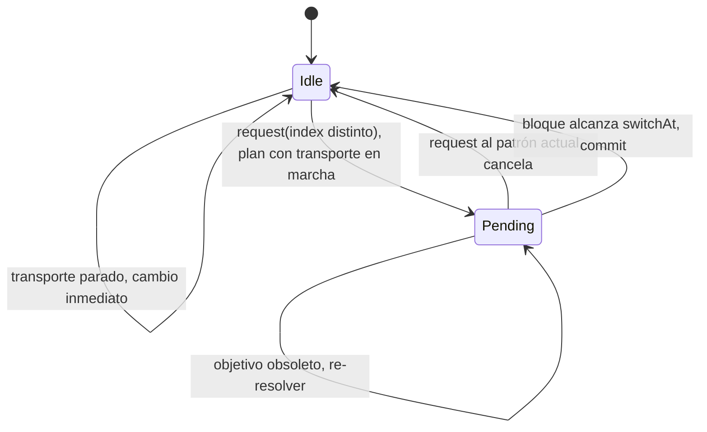

Cuantización: `Now` (inmediato), `Beat` (próxima negra entera), `Bar` (próximo múltiplo de `beatsPerBar` del host; un bloque que empieza justo en el borde cambia de inmediato). Por defecto `Bar` mientras suena; con el transporte parado el cambio es inmediato (ADR-011).

### 5.6 Auditioner (preview de notas)

Cuando se activa un paso en el editor suena su nota una vez (ADR-019). El `Auditioner` tiene 16 voces, longitud fija de 200 ms, note-on en el frame 0 del siguiente bloque, note-off exacto por muestra; reactivar una nota que suena hace off+on; sin voces libres roba la más cercana a su fin. Funciona con el transporte parado y no lo conoce el `Sequencer`.

---

## 6. Handoff main → audio

### 6.1 Triple buffer (`SnapshotExchange`)

El hilo principal copia el `Model` a un `EngineSnapshot` y lo publica; el audio hace `acquire()` una vez por bloque y lee ese slot completo. Sin asignación, locks ni borrados en audio (ADR-006).

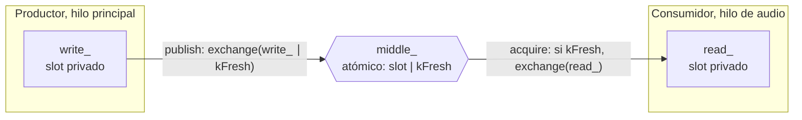

Con 3 slots, el productor nunca escribe un slot que el consumidor pueda estar leyendo, y el consumidor siempre ve un snapshot completo (sin *tearing*; probado con un hilo productor).

### 6.2 Resumen de canales

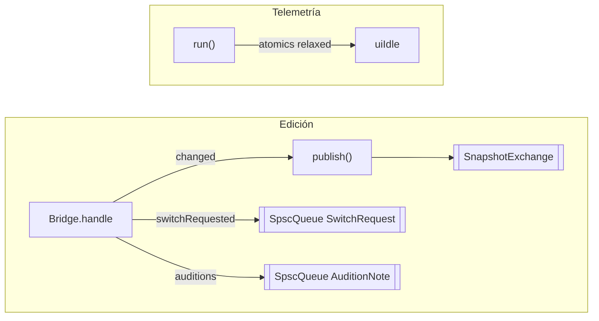

Políticas ante saturación: las colas llenas **descartan lo más nuevo** (UI martillando); el outbox, si llega a 512 entradas sin que la UI drene (oculta o cerrada), se reemplaza por un único evento `init` (resincronización completa).

---

## 7. Bridge: comandos y eventos

El `Bridge` (`bridge/Bridge.cpp`, hilo principal) es la **única** puerta de mutación del `Model`: la UI nativa lee el modelo directamente pero escribe solo mediante comandos JSON. Así la validación, la atomicidad y el undo son uniformes (ADR-008, ADR-014).

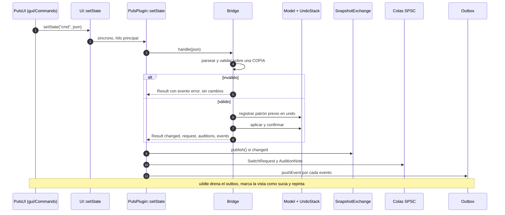

### Comandos (todos llevan `"version":1`)

| Grupo | Comandos |
|---|---|
| Pasos | `toggleStep`, `setStepVelocity`, `modifyStep`, `editSteps` (≤ 1024 celdas, atómico, un paso de undo) |
| Tracks | `addTrack`, `removeTrack`, `modifyTrack` (puede llevar `preview`), `previewNote` |
| Banco | `selectPattern {quantize}`, `renamePattern`, `copyPattern`, `pastePattern`, `duplicatePattern`, `clearPattern` |
| Templates | `applyTemplate` (undoable), `saveTemplate`, `deleteTemplate` (no undoables; responden `templates`) |
| Global | `setSettings`, `undo`, `redo`, `hello` |

`setStepVelocity`, `modifyStep` y `modifyTrack` pueden llevar un `gesture` ≠ 0 para fusionar un arrastre en un solo paso de undo.

### Eventos

`init`, `stepChanged`, `stepsChanged`, `trackChanged`, `patternChanged`, `bankChanged`, `settings`, `history`, `clipboard`, `templates`, `error`. El transporte y los playheads **no** son eventos: la UI los lee de la telemetría. En la UI nativa el outbox es solo una señal de "sucio" más los mensajes de error.

### `Bridge::Result`

| Campo | Para quién |
|---|---|
| `events` | Outbox → UI |
| `changed` | `PulsPlugin` debe republicar el snapshot |
| `switchRequested` + `request` | Cola hacia el hilo de audio |
| `auditions` | Cola hacia el `Auditioner` |

Reglas de validación: un comando se aplica a una copia y se confirma solo si **todas** las claves presentes son válidas; el estado persistido es aún más estricto (ver §9).

---

## 8. Editor nativo

El editor se dibuja con NanoVG (`UI_TYPE=opengl`, fuente DejaVu Sans incluida). Reemplazó al WebView (ADR-014), que en Linux lanzaba WebKitGTK como procesos aparte y causaba picos de CPU. Medido: ~1,4 % de CPU total con 8 tracks sonando.

### 8.1 Partes

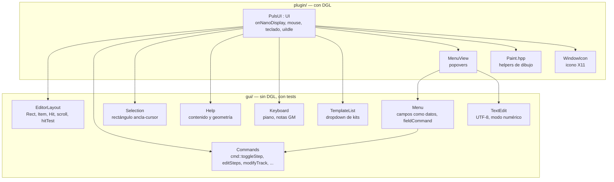

### 8.2 Ciclo de interacción

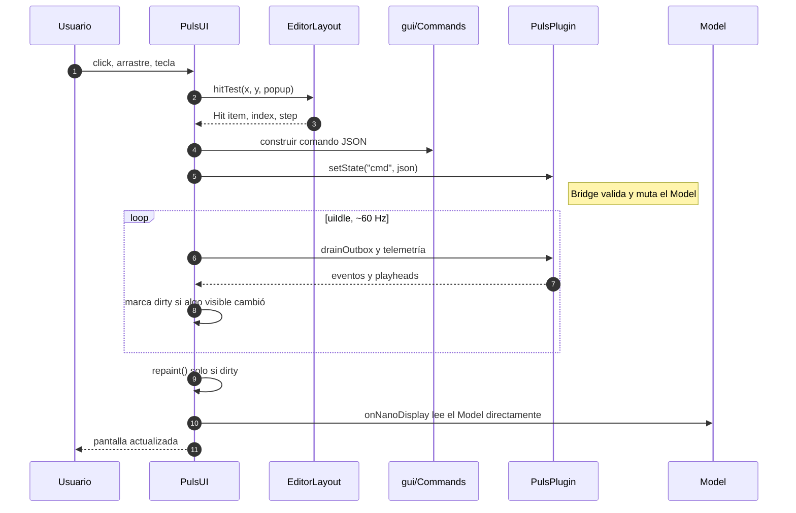

Decisiones de rendimiento y robustez:

- **Repinta solo si cambió algo visible** (playhead, valor de transporte, edición, animación). Un editor ocioso no cuesta nada; uno en reproducción repinta como máximo una vez por paso.
- **Arrastres y sliders se acoplan:** como máximo un comando por tick de idle, con un único `gesture` id (un arrastre = un paso de undo).
- **Layout en píxeles lógicos** × factor de escala del host. Tamaño mínimo 800×240.
- **Atajos de teclado** solo con el foco en la ventana del plugin; orden de entrega: campos de texto → popover abierto → grilla. Se ignoran con un popup de la barra abierto.

### 8.3 Superficies de la UI

| Superficie | Contenido |
|---|---|
| Barra de herramientas | Undo/redo, enable, ♪ audition, piano, resolución, swing, ±track, ajustes, ayuda |
| Barra del banco | 16 slots, botón **Kit ▾**, texto de transporte |
| Grilla | Etiquetas de track (M/S, longitud), celdas de pasos, scroll horizontal, playheads |
| Popovers (click derecho) | Paso, track, patrón; sliders y campos de texto |
| Overlays modales | Ayuda; teclado de notas con una nota por track (ADR-020) |
| Dropdown de templates | Built-in / Mis templates / guardar como… |

---

## 9. Persistencia y templates

### 9.1 Estado del proyecto

El host guarda y restaura una única clave de estado, `"state"` (`kStateIsHostReadable | kStateIsHostWritable`), con el JSON de `state/Serialization`.

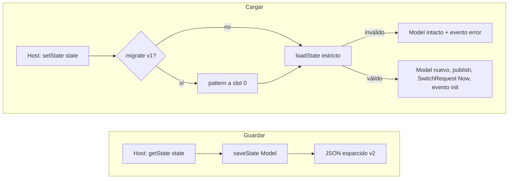

Esquema v2:

```json
{
  "schemaVersion": 2,
  "selected": 0,
  "patterns": [ { "name": "...", "seed": 1, "template": "bitwig-v8-edrums-01", "tracks": [ ... ] } ],
  "settings": { "anchorMode": "...", "enabled": true, "patternSwitch": "bar", "audition": true }
}
```

- **Esparcido:** los campos de paso iguales al valor por defecto se omiten y los pasos finales por defecto se descartan.
- **Estricto y atómico:** un valor inválido rechaza todo el estado; el modelo conserva el anterior.
- **No se persisten:** historial de undo, portapapeles, playheads.
- Los slots faltantes se rellenan con patrones en blanco; los documentos antiguos se migran sin perder datos (`template` es una clave opcional, el esquema sigue en v2).

### 9.2 Templates (kits)

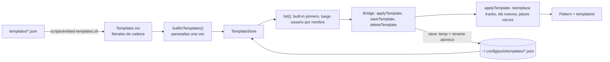

Los built-ins se embeben en el binario porque el CLAP de Linux es un único archivo sin recursos. Los templates de usuario se leen con `readTrackProps`, la misma definición que usan los proyectos, y la lista se relee cada vez que se abre el dropdown (así aparecen los guardados por otra instancia). Solo se usa el hilo principal.

---

## 10. Undo/redo

`model/UndoStack` guarda hasta **100 snapshots de patrón completo** (heap, hilo principal). El Bridge copia el patrón antes de cada comando y lo registra solo si el comando cambió algo. Los ajustes (`setSettings`) no son deshacibles.

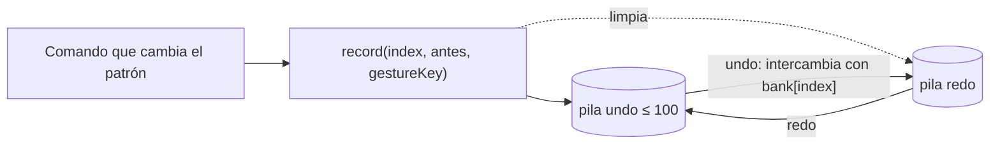

- **Coalescencia por gesto:** comandos consecutivos con el mismo `gesture`/track/paso conservan solo el primer estado "antes".
- Undo restaura el patrón al que pertenece la entrada y lo muestra, pero **no cambia lo que suena**.
- Un `modifyTrack` que no cambia nada no se registra y conserva la pila de redo.

---

## 11. Glue con DPF/CLAP (`plugin/`)

`PulsPlugin` es la clase DPF `Plugin` y el único lugar donde se encuentran los dos mundos.

| Método DPF | Qué hace |
|---|---|
| constructor | Crea el banco por defecto, publica el primer snapshot, lee `PULS_TRACE` |
| `initState` / `getState` / `setState("state")` | Persistencia del proyecto (§9) |
| `setState("cmd")` | Entrada de comandos de la UI (§7) |
| `activate` / `deactivate` | `Sequencer::reset()` y `Auditioner::reset()` |
| `run` | Bloque de audio (§5.1) |

Metadatos: label `puls`, maker `VoiSpeak`, id único `Puls`, versión 0.0.1. `DistrhoPluginInfo.h` declara el plugin como note effect con puerto de notas de salida y UI OpenGL.

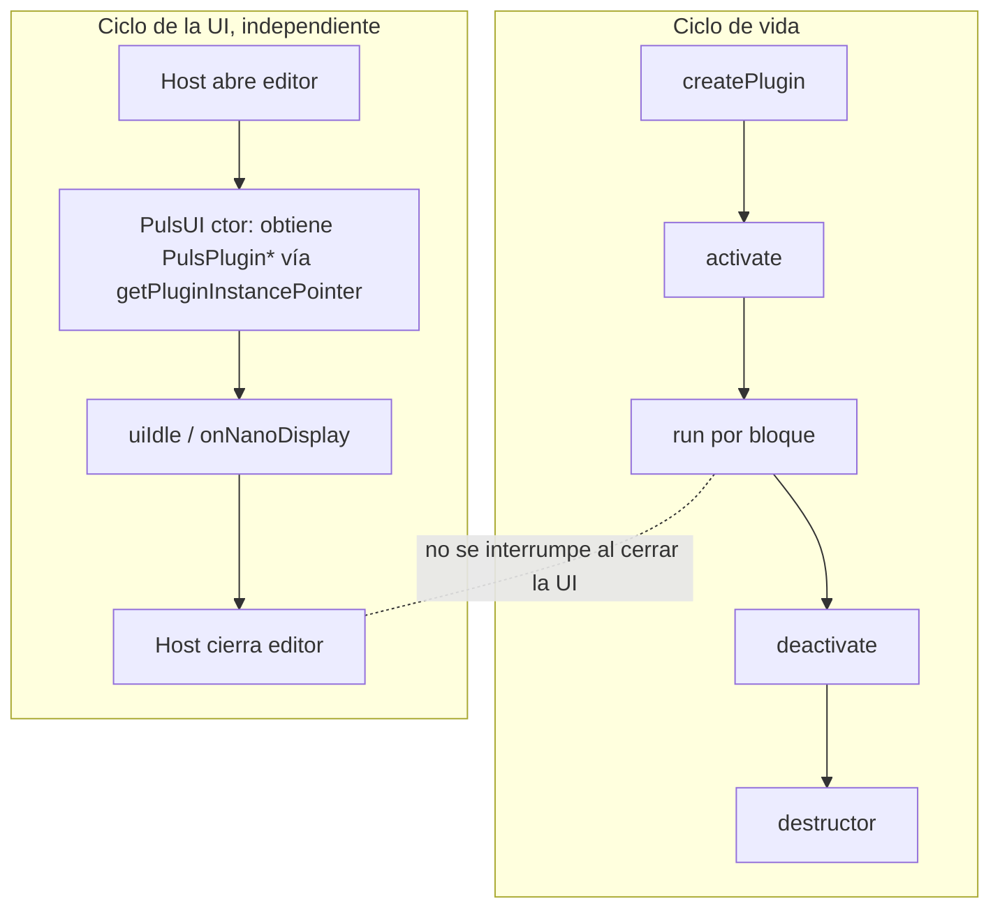

El `PulsUI` se enlaza con el plugin por `getPluginInstancePointer()` y solo usa su API de hilo principal (`model()`, `templates()`, `drainOutbox()`, `drainTrace()`) y los atomics de telemetría.

---

## 12. Build, dependencias y tests

### 12.1 Cadena de build

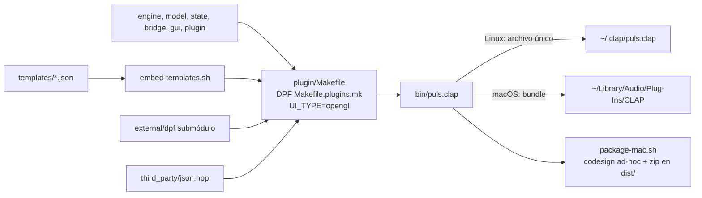

Notas: se compila con `-fno-fast-math` (el `-ffast-math` de DPF eliminaría las guardas `isfinite` del motor y rompería el manejo de infinitos de `json.hpp`, ADR-007); Linux usa `gnu++20`, macOS `c++20`. `build.sh` fuerza el SDK de Xcode en macOS.

### 12.2 Estructura de tests

Cada biblioteca de CMake se corresponde con una capa, de modo que un test de una capa no arrastra a las superiores.

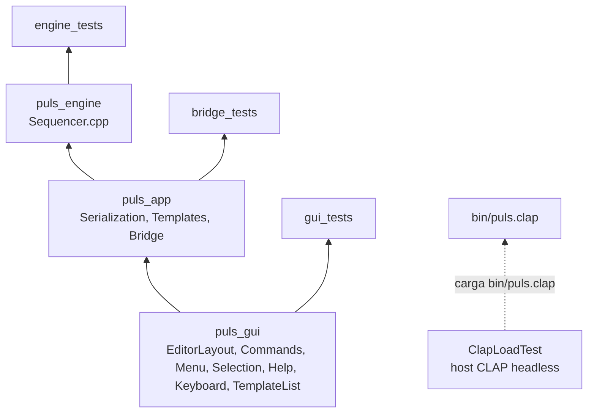

| Suite | Cubre |
|---|---|
| `engine_tests` | Temporización, independencia del tamaño de bloque, switching, auditioner, triple buffer y cola SPSC con hilo productor, política de overflow |
| `bridge_tests` | Validación atómica, undo/redo, banco, templates, auditions, serialización y migración v1 |
| `gui_tests` | Layout, hit-testing, builders de comandos, menús, selección, teclado, ayuda, dropdown |
| `ClapLoadTest` | Carga real de `puls.clap`: metadatos, puertos de notas, round-trip de estado, temporización de note-on/off |

Scripts: `scripts/validate.sh` (tests + host headless + `clap-validator` si existe), `scripts/sanitize.sh` (ASan/UBSan/TSan), `scripts/build.sh`, `scripts/install-mac.sh`, `scripts/package-mac.sh`, `scripts/embed-templates.sh`.

---

## 13. Diagnóstico

Con `PULS_TRACE=<archivo>` en el entorno al crear el plugin, `run()` encola un `TraceRecord` por bloque (wait-free, `SpscQueue<…,8192>`, ~40 s a 48 kHz/512) y `uiIdle` los vuelca como CSV: frame del host, tamaño de bloque, estado de play, validez de bbt, posición, tempo, `BlockKind`, número de eventos, playhead del track 1 y patrón sonando. **El editor debe estar abierto mientras se graba.** Los registros perdidos se anotan en el archivo.

Es la herramienta para decidir si una irregularidad es del host (p. ej. automatización de tempo) o de Puls antes de tocar el motor (ADR-018).

---

## 14. Plataformas y limitaciones

| Plataforma | Estado |
|---|---|
| Linux x86_64 | Compila (UI nativa), tests headless y sanitizers limpios; probado en el standalone JACK y en Bitwig |
| macOS arm64 | La UI nativa **no** se ha compilado ni ejecutado ahí todavía (solo la era WebView) |
| macOS x86_64, Windows | No compilado |

No se afirma soporte en una plataforma hasta compilarla y ejecutarla en ella. Solo se ha probado Bitwig como host; `clap-validator` aún no se ha ejecutado.

Limitaciones conocidas:

- Los cambios de compás durante la reproducción no se siguen para los cambios de patrón por compás (se usa el compás del bloque actual).
- Patrones extremadamente densos (> ~2000 candidatos por bloque) descartan los note-on más nuevos; los note-off jamás.
- Las notas de preview no las sigue el `Sequencer`: su note-off puede cortar una nota secuenciada del mismo tono y canal (inocuo para batería *one-shot*).
- Sin entrada MIDI, sin nota/pitch por paso, sin salida de audio.
- Los atajos de teclado dependen de que el host reenvíe el foco a la ventana del plugin.

---

## Apéndice: tabla de ADR relevantes

| ADR | Tema |
|---|---|
| 002 | Tiempo entero (PPQ 3840) |
| 005 | Posición de negra del host desde bbt |
| 006 | Triple buffer de snapshots |
| 007 | nlohmann/json solo fuera de RT; `-fno-fast-math` |
| 008 | Validación atómica y estricta del Bridge |
| 010 | Undo por snapshots, coalescencia por gesto |
| 011 | Banco de 16 patrones y cambio cuantizado |
| 012 | Esquema v2 con migración v1 |
| 014 | UI nativa NanoVG (reemplaza WebView) |
| 018 | Tolerancia a errores de posición del host; traza |
| 019 | Preview de notas |
| 021 | Una nota por canal y patrón |
| 022 | Templates |

> ADR-001, ADR-003 (lado UI), ADR-004, ADR-013 y ADR-015/016 describen la etapa WebView o su migración; ADR-014 los reemplaza.
